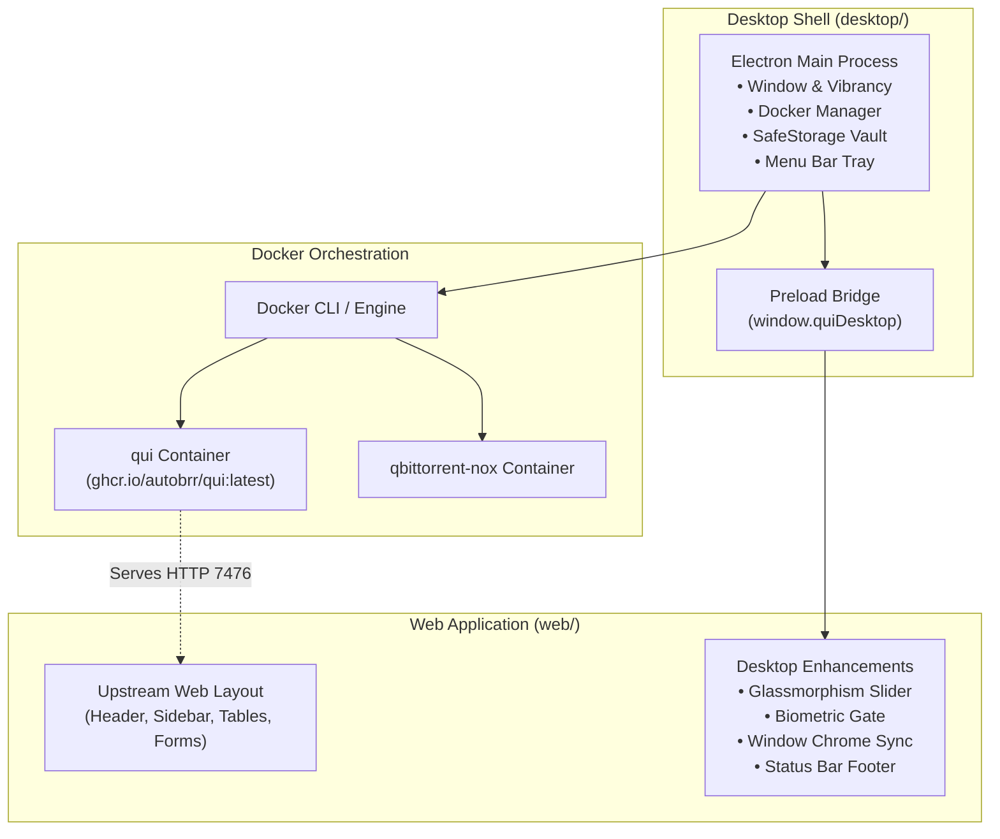
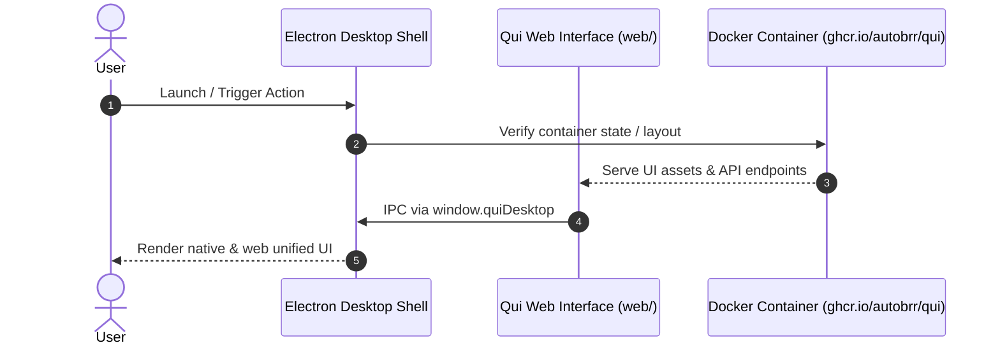

# Qui Fork Issue Crafting

When crafting GitHub Issues for this project (using `$github-issue-crafting` or native planning), you **must adhere to the architectural reality of this repository**:

1. **Fork Purpose:** This repository (`Johann-Goncalves-Pereira/Qui`) is a specialized fork of upstream Qui (`autobrr/qui`) whose goal is to build, package, and maintain a native **Desktop Application for Qui** (wrapped in Electron under `desktop/`, featuring native Touch ID biometrics, menu bar transfer rates, macOS window HUD vibrancy / Glassmorphism, and Docker lifecycle management).
2. **Upstream Docker Layout Dependency:** The desktop application embeds and wraps the Qui web UI (`web/`), and orchestrates containers based on the upstream project's Docker image (`ghcr.io/autobrr/qui`). The UI layout directly reflects what the Docker image pushes from the original project.
3. **Future Breakage Risk:** The upstream project changes independently. Future updates to the upstream Docker image can alter layout structures, DOM hierarchies, CSS classes, routes, or backend APIs. **These upstream changes can easily collide with or break this desktop application.**

Every issue crafted in this repository must explicitly account for this fork context and Docker layout risk.

---

## 1. Architectural Layers & Scope Separation

When writing issues, categorize the scope into distinct architectural layers:



| Layer | Path | Description & Upstream Risk |
| :--- | :--- | :--- |
| **Desktop Shell** | `desktop/` | Native Electron wrapper. Isolated from upstream code, but depends on Docker CLI and Qui HTTP availability. |
| **Web UI** | `web/` | **High Upstream Risk.** Touches components that upstream also modifies. Layout must follow what Docker pushes while cleanly layering desktop enhancements. |
| **Docker Engine** | `desktop/src/main/docker.ts`, `container-layout.ts` | Manages volume bindings (`/config`, `/downloads`) and container parameters for upstream images. |
| **Backend / Themes** | `internal/`, `cmd/` | Core Go server. Kept in parity with upstream `autobrr/qui`. Custom theme overrides must not break API contracts. |

---

## 2. Mandatory Issue Section: Upstream Docker Alignment & Breaking Risk

In addition to standard `$github-issue-crafting` sections (Motivation, Solution, Checklist, Acceptance Criteria), **every issue in this repository must include the following dedicated section**:

````markdown
## ⚠️ Upstream Docker Alignment & Breaking Change Risk

- **Target Architectural Layer:** [Desktop Shell `desktop/` | Web UI `web/` | Docker Orchestration | Backend `internal/`]
- **Upstream Layout Coupling:** [High | Medium | Low | None]
- **Potential Breakage Vectors:**
  - Describe what upstream Docker image changes (e.g. DOM modifications, header/sidebar refactoring, route changes, API deprecation) could break this implementation.
- **Defensive Guardrails & Isolation:**
  - How is this feature guarded? (e.g., checks `window.quiDesktop`, resilient CSS rather than brittle DOM selectors, non-intrusive component wrapping).
  - Standalone browser fallback: Does the web app continue working properly in a standard web browser without throwing exceptions when the desktop bridge is absent?
- **Future Upstream Sync Impact:**
  - Will this change cause git merge conflicts or require re-patching when rebasing on new `autobrr/qui` upstream releases?
````

---

## 3. Rules of Engagement for Issue Crafting

Follow all golden rules from `$github-issue-crafting`, with fork-specific requirements:

1. **Title Case Humanized Titles (No conventional-commit prefixes):**
   - ❌ `feat(desktop): add container health footer`
   - ❌ `fix: glassmorphism theme breaking header`
   - ✅ `Add Status Bar Footer with Live Docker Container Health`
   - ✅ `Preserve Desktop Window Chrome Alignment When Upstream Header Resizes`
2. **Defensive Layout Design:**
   - Always prefer CSS utility overlays or layout wrappers over mutating core upstream JSX trees.
   - If tweaking header heights, sidebar width, or view modes (e.g. `lg:h-12` vs `lg:h-16`), ensure responsive breakpoints and standard upstream controls remain unclipped.
3. **Traceability to Spec Catalog & Docs First (`050-docs.mdc`):**
   - Every behavioral change requires a new or updated row in `docs/specs/catalog.md` (`BR-desktop-XX` or `BR-web-XX`).
   - The issue checklist must require updating `docs/desktop/overview.md` or `docs/web/electron-desktop.md` and writing the failing test before implementing code.
4. **Universal Labels:**
   - Type: `✨ Feature`, `🐛 Bug`, `🛠️ Chore`, `🚀 Epic`
   - Priority: `🔴 Priority: Critical`, `🟠 Priority: High`, `🟡 Priority: Medium`, `🟢 Priority: Low`
   - Scope: `🌐 Frontend`, `🎨 UI / UX`, `🐳 DevOps / Infra`, `🔒 Auth / Security`
   - Status: Always start at `📋 Triage`

---

## 4. Templates

### Feature / Enhancement Template

````markdown
## 💡 Motivation & Business Context
Why this feature is needed in the Qui Desktop application, who benefits, and what UX problem it solves.

## 📊 Flow / Architecture Diagram


## 🚀 Proposed Solution
Detailed technical approach across the desktop shell, web layer, or Docker orchestration.

## ⚠️ Upstream Docker Alignment & Breaking Change Risk
- **Target Architectural Layer:** Web UI `web/` & Desktop Shell `desktop/`
- **Upstream Layout Coupling:** Medium
- **Potential Breakage Vectors:** Future upstream Docker updates modifying layout CSS classes or navigation items.
- **Defensive Guardrails & Isolation:**
  - Guard desktop IPC under `if (window.quiDesktop)`.
  - Fall back gracefully to standard browser UI when desktop bridge is missing.
- **Future Upstream Sync Impact:** Kept isolated in dedicated components to minimize git rebase friction against `autobrr/qui`.

## 🚫 Out of Scope
- What is explicitly not included in this iteration.

## 📋 Implementation Checklist
- [ ] Add spec rule to `docs/specs/catalog.md` (`BR-desktop-XX` or `BR-web-XX`)
- [ ] Update documentation in `docs/desktop/overview.md` or `docs/web/electron-desktop.md`
- [ ] Write failing unit / integration tests before production code
- [ ] Implement changes in `desktop/` or `web/`
- [ ] Verify standalone web fallback (browser mode without Electron)
- [ ] Run `./scripts/validate` and pass all linters, TypeScript, and test suites

## ✅ Acceptance Criteria (Definition of Done)
- [ ] Feature functions as specified in the desktop environment
- [ ] Layout remains visually coherent and resilient to upstream Docker UI structures
- [ ] All unit, integration, and linter checks pass (`./scripts/validate`)
- [ ] Spec catalog and documentation updated and marked complete
````

### Bug Report Template (Layout / Docker Regression)

````markdown
## 🐛 Bug Summary
Description of defect, affected desktop components, and layout collision with the upstream Docker container.

## 🔍 Steps to Reproduce
1. Launch Qui Desktop application (or boot Docker container).
2. Navigate to '...'
3. Observe layout breakage or broken IPC call.

## ⚠️ Expected vs Actual
- **Expected:** ...
- **Actual:** ...

## 🖼️ Visual Evidence
<!-- Attach screenshot or visual comparison -->


## ⚠️ Upstream Docker Alignment & Breaking Change Risk
- **Origin of Defect:** [Upstream Docker image update | Desktop shell discrepancy | Electron bridge failure]
- **Affected Upstream Contract:** Detail any changed CSS selector, DOM element, or endpoint.
- **Remediation Strategy:** Make layout selector resilient or decouple from upstream DOM.

## 🛠️ Root Cause / Proposed Fix
Technical analysis of root cause and proposed fix.

## 📋 Work Checklist
- [ ] Reproduce defect with failing test case
- [ ] Implement defensive patch
- [ ] Verify no regressions in standalone browser mode
- [ ] Run `./scripts/validate`

## ✅ Verification & Acceptance Criteria
- [ ] Defect resolved across all supported view modes
- [ ] Regression coverage added
- [ ] All quality checks pass cleanly
````

---

## 5. Execution Workflow with `gh`

When creating the issue, execute the following preflight:

````bash
REPO=$(gh repo view --json nameWithOwner -q .nameWithOwner)
bash "$HOME/.cursor/skills/github-issue-crafting/scripts/ensure-labels.sh" "$REPO"

BODY_FILE="$(mktemp -t qui-issue.XXXXXX.md)"
trap 'rm -f "$BODY_FILE"' EXIT

# Populate BODY_FILE with the markdown template including the Upstream Docker Alignment section

gh issue create \
  -R "$REPO" \
  --title "<Title Case Humanized Title>" \
  --assignee "@me" \
  --label "✨ Feature" \
  --label "🟡 Priority: Medium" \
  --label "🌐 Frontend" \
  --label "🎨 UI / UX" \
  --label "📋 Triage" \
  --body-file "$BODY_FILE"
````
