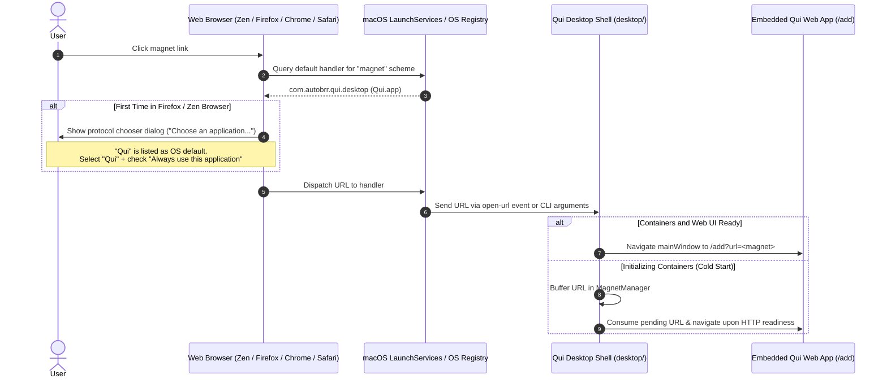

# Magnet Protocol Handler & Browser Association

**Status:** shipped

Qui Desktop is designed to handle `magnet:` URIs natively across macOS, Linux, and Windows. When a user clicks a magnet link in their web browser or another native application, the operating system dispatches the link to Qui Desktop, which automatically opens the application window (restoring it if minimized) and navigates to the `/add?url=<magnet>` route in the embedded Qui web interface.

## Architecture & Lifecycle

## Protocol Registration

In the Electron desktop shell (`desktop/src/main/magnet.ts` and `desktop/src/main/index.ts`):
1. **Packaging Declaration:** `desktop/package.json` configures `build.protocols` with name `"Magnet URI Scheme"`, scheme `"magnet"`, and role `"Viewer"`. This ensures `electron-builder` generates the appropriate `CFBundleURLTypes` entry in macOS `Info.plist` and registers scheme associations on Windows and Linux.
2. **Runtime Registration:** On application startup, `registerMagnetProtocolHandler(app)` calls `app.setAsDefaultProtocolClient('magnet')`.
3. **Status Verification:** The registration utility checks `app.isDefaultProtocolClient('magnet')` to verify that Qui is recognized as the active protocol client.
4. **Resilient Buffering:** If Qui is launched cold via a magnet link, the Docker containers and backend HTTP service take a few seconds to boot. `MagnetManager` buffers the magnet URL, brings the window to the front with the startup progress page, and automatically navigates to `/add?url=...` once `openWrappedQui` verifies HTTP readiness.

## Browser Association & Chooser Dialogs

### Zen Browser & Mozilla Firefox

When clicking a magnet link for the first time in Zen Browser or Mozilla Firefox on macOS:
1. Firefox displays a dialog: *"Choose an application to open the magnet link"*.
2. **Visual layout:**
   - The top row displays `Qui`. Because Firefox's `appChooser.js` does not request or render icons for the OS default handler (`os-default-handler`), `Qui` appears as plain text.
   - The second row displays `Choose other Application` (with a `Choose...` button) and is pre-selected by default with an active cyan highlight.
3. **Action required:**
   - Click directly on the **`Qui`** row to select it.
   - Check **"Always use this application to open magnet links"**.
   - Click **"Open Link"**.
   - This records the selection in Firefox's `handlers.json` (`"action": 2, "ask": false`), and future clicks will launch directly into Qui without prompting.

### Google Chrome & Chromium-based Browsers

Chromium displays a standard confirmation bubble: *"Open Qui? https://... wants to open this application."* Checking *"Always allow ... to open links of this type"* permanently binds the association.

### Apple Safari

Safari displays: *"Do you want to allow this page to open 'Qui'?"*. Clicking **Allow** opens Qui directly.

## Related spec

- `BR-desktop-47` in `docs/specs/catalog.md` — Desktop shell registers as the default OS handler for magnet protocol, verifies `isDefaultProtocolClient` status, and seamlessly buffers and routes magnet URLs to Qui `/add` endpoint.
