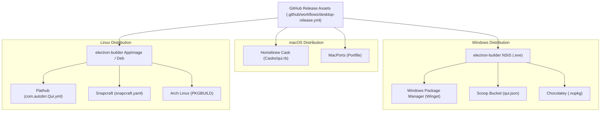

# Package Managers & Distribution Guide

**Status:** shipped (macOS Homebrew Cask) / planned (Windows & Linux)

Qui Desktop is distributed across package managers to allow fast, command-line
installation, seamless upgrades, and clean uninstallation.

This document details:
1. **Homebrew Cask (macOS)** — Active distribution via canonical formula `Casks/qui.rb`.
2. **Future Package Managers Roadmap** — Implementation blueprints for Windows
   (Winget, Scoop, Chocolatey) and Linux (Flatpak, Snap, AppImage, AUR).

---

## 1. Homebrew Cask (macOS)

Homebrew Cask installs compiled GUI macOS applications (`.app`) from release
disk images (`.dmg`). The canonical Cask specification for Qui Desktop is maintained
in [`Casks/qui.rb`](../../Casks/qui.rb).

### Prerequisites

- macOS 12+ (Apple Silicon `arm64` or Intel `x64`).
- [Homebrew](https://brew.sh) installed.
- [Docker Desktop](https://www.docker.com/products/docker-desktop/) or OrbStack installed and running.

---

### Installation Methods

#### Method A: Direct Repository Tap (Recommended)

Users can tap the Qui repository directly via GitHub URL:

```bash
# 1. Tap the Qui repository
brew tap Johann-Goncalves-Pereira/qui https://github.com/Johann-Goncalves-Pereira/Qui

# 2. Trust the third-party tap (Homebrew 7+ requirement)
brew trust Johann-Goncalves-Pereira/qui

# 3. Install Qui Cask
brew install --cask qui
```

#### Method B: Dedicated Tap Repository (`homebrew-qui`)

If maintainers establish a dedicated GitHub tap at `Johann-Goncalves-Pereira/homebrew-qui`,
users can use standard shorthand syntax:

```bash
brew tap Johann-Goncalves-Pereira/qui
brew install --cask qui
```

#### Method C: Direct Raw URL (One-Liner)

Install directly without registering a persistent tap:

```bash
brew install --cask https://raw.githubusercontent.com/Johann-Goncalves-Pereira/Qui/develop/Casks/qui.rb
```

#### Method D: Local Checkout Testing (Developers)

For local development and testing on macOS:

```bash
git clone https://github.com/Johann-Goncalves-Pereira/Qui.git
cd Qui

# Tap the local worktree
brew tap local/qui "file://$(pwd)"
brew trust local/qui
brew install --cask local/qui/qui
```

---

### Managing the Application

#### Upgrading

When a new version tag is published on GitHub Releases:

```bash
brew upgrade --cask qui
```

#### Complete Uninstallation (Zap)

To uninstall Qui and cleanly remove all local configurations, Docker bind-mount
caches, Electron storage, and macOS preferences:

```bash
brew uninstall --cask --zap qui
```

The `zap` stanza removes:
- `~/Library/Application Support/Qui` (Docker config bind mounts, local digest caches, SafeStorage vault)
- `~/Library/Caches/com.autobrr.qui.desktop`
- `~/Library/Caches/com.autobrr.qui.desktop.ShipIt`
- `~/Library/Preferences/com.autobrr.qui.desktop.plist`
- `~/Library/Saved Application State/com.autobrr.qui.desktop.savedState`

---

### macOS Gatekeeper Notice (Unsigned Binaries)

Qui Desktop releases are currently unsigned (no Apple Developer ID certificate).
When launching the app for the first time, macOS Gatekeeper may display a warning.

To allow Qui Desktop:

1. **Option 1 (Terminal command):**
   ```bash
   xattr -cr /Applications/Qui.app
   ```
2. **Option 2 (System Settings):**
   Open **System Settings → Privacy & Security**, scroll down to the Security section,
   and click **Open Anyway** next to Qui.

---

### Maintainer Guide: Updating `Casks/qui.rb`

When releasing a new version of Qui Desktop (e.g. `v1.1.0`):

1. **Locate Release Artifacts:**
   Verify GitHub Actions has published the release assets:
   - `Qui-1.1.0-arm64.dmg`
   - `Qui-1.1.0-x64.dmg` (or universal `.dmg`)
2. **Update Version in `Casks/qui.rb`:**
   ```ruby
   version "1.1.0"
   ```
3. **Compute SHA256 Checksums (Optional for pinned releases):**
   ```bash
   curl -sL "https://github.com/Johann-Goncalves-Pereira/Qui/releases/download/v1.1.0/Qui-1.1.0-arm64.dmg" | shasum -a 256
   curl -sL "https://github.com/Johann-Goncalves-Pereira/Qui/releases/download/v1.1.0/Qui-1.1.0-x64.dmg" | shasum -a 256
   ```
   Update the `sha256` stanza:
   ```ruby
   sha256 arm:   "<arm64-sha256-hash>",
          intel: "<x64-sha256-hash>"
   ```
4. **Submit to Upstream `homebrew/cask` (Future Milestone):**
   Once official Apple code signing and notarization are configured, submit a PR to
   `Homebrew/homebrew-cask`:
   ```bash
   brew bump-cask-pr --version 1.1.0 qui
   ```

---

## 2. Future Package Managers Onboarding Blueprint

While current development targets macOS, Qui Desktop is engineered to be portable.
The following blueprints define how to support other package managers when expanding
to Windows and Linux.



---

### A. Windows Package Managers

#### 1. Windows Package Manager (Winget)

- **Artifact Requirement:** `desktop/package.json` targets `nsis` (`dist/Qui Setup <version>.exe`).
- **Silent Flags:** `/S`
- **Manifest Location:** `microsoft/winget-pkgs` repository under `manifests/j/Johann-Goncalves-Pereira/Qui/<version>/`.
- **Manifest Example (`Johann-Goncalves-Pereira.Qui.installer.yaml`):**
  ```yaml
  PackageIdentifier: Johann-Goncalves-Pereira.Qui
  PackageVersion: 1.0.0
  InstallerType: nullsoft
  Installers:
    - Architecture: x64
      InstallerUrl: https://github.com/Johann-Goncalves-Pereira/Qui/releases/download/v1.0.0/Qui-Setup-1.0.0.exe
      InstallerSha256: <x64-sha256>
      Scope: machine
    - Architecture: arm64
      InstallerUrl: https://github.com/Johann-Goncalves-Pereira/Qui/releases/download/v1.0.0/Qui-Setup-1.0.0-arm64.exe
      InstallerSha256: <arm64-sha256>
      Scope: machine
  ```
- **Automated Publishing:** Use `winget-create` or GitHub Action `vedantmgoyal2009/winget-releaser` on release tags.

#### 2. Scoop

- **Artifact Requirement:** Portable `.zip` or NSIS `.exe`.
- **Manifest Example (`bucket/qui.json`):**
  ```json
  {
    "version": "1.0.0",
    "description": "Native qBittorrent desktop manager with Electron and Docker companion services",
    "homepage": "https://github.com/Johann-Goncalves-Pereira/Qui",
    "license": "GPL-2.0-or-later",
    "architecture": {
      "64bit": {
        "url": "https://github.com/Johann-Goncalves-Pereira/Qui/releases/download/v1.0.0/Qui-1.0.0-win.zip",
        "hash": "<sha256>"
      }
    },
    "shortcuts": [
      ["Qui.exe", "Qui"]
    ],
    "persist": "data",
    "checkver": "github",
    "autoupdate": {
      "architecture": {
        "64bit": {
          "url": "https://github.com/Johann-Goncalves-Pereira/Qui/releases/download/v$version/Qui-$version-win.zip"
        }
      }
    }
  }
  ```

#### 3. Chocolatey

- **Package Manifest (`qui.nuspec`)**: References `tools/chocolateyInstall.ps1`.
- **Install Script:**
  ```powershell
  $ErrorActionPreference = 'Stop'
  $packageArgs = @{
    packageName   = 'qui'
    unzipLocation = "$(Split-Path -parent $MyInvocation.MyCommand.Definition)"
    fileType      = 'exe'
    url64         = 'https://github.com/Johann-Goncalves-Pereira/Qui/releases/download/v1.0.0/Qui-Setup-1.0.0.exe'
    checksum64    = '<sha256>'
    checksumType64= 'sha256'
    silentArgs    = '/S'
    validExitCodes= @(0)
  }
  Install-ChocolateyPackage @packageArgs
  ```

---

### B. Linux Package Managers

#### 1. Flatpak (Flathub)

- **Application ID:** `com.autobrr.Qui`
- **Docker Socket Consideration:** Because Flatpak runs in a strict sandbox, accessing the Docker daemon CLI requires specific filesystem permissions in the manifest:
  ```yaml
  finish-args:
    - --share=ipc
    - --share=network
    - --socket=x11
    - --socket=wayland
    - --device=dri
    - --filesystem=/var/run/docker.sock
    - --filesystem=xdg-run/docker.sock
  ```
- **Manifest Structure:** `com.autobrr.Qui.yml` pulling the pre-built Linux tarball or AppImage, extracting to `/app`, and installing desktop entry and icons.

#### 2. Snapcraft (Snap)

- **Confinement:** `classic` or `strict` with `docker` plug:
  ```yaml
  name: qui
  base: core24
  version: '1.0.0'
  summary: Qui Desktop - Native qBittorrent WebUI with Electron
  confinement: classic
  parts:
    qui:
      plugin: dump
      source: https://github.com/Johann-Goncalves-Pereira/Qui/releases/download/v1.0.0/Qui-1.0.0.tar.gz
  apps:
    qui:
      command: Qui
      plugs: [network, network-bind, x11, wayland, docker]
  ```

#### 3. Arch User Repository (AUR)

- **Package Name:** `qui-desktop-bin`
- **`PKGBUILD` Example:**
  ```bash
  # Maintainer: Johann Gonçalves Pereira
  pkgname=qui-desktop-bin
  pkgver=1.0.0
  pkgrel=1
  pkgdesc="Qui Desktop - Native qBittorrent desktop manager with Electron and Docker companion services"
  arch=('x86_64' 'aarch64')
  url="https://github.com/Johann-Goncalves-Pereira/Qui"
  license=('GPL-2.0-or-later')
  depends=('gtk3' 'nss' 'libxss' 'docker')
  source_x86_64=("https://github.com/Johann-Goncalves-Pereira/Qui/releases/download/v${pkgver}/Qui-${pkgver}.AppImage")
  sha256sums_x86_64=('<sha256>')

  package() {
      install -Dm755 "${srcdir}/Qui-${pkgver}.AppImage" "${pkgdir}/usr/bin/qui"
  }
  ```

---

## 3. Related Specifications & Architecture

- `BR-desktop-23` — Canonical Homebrew Cask distribution specification, zap coverage, and package manager blueprints.
- [`docs/desktop/overview.md`](overview.md) — Main desktop architecture and lifecycle.
- [`docs/desktop/updates.md`](updates.md) — Unsigned GitHub release asset management.
- [`Casks/qui.rb`](../../Casks/qui.rb) — Homebrew Cask formula.
