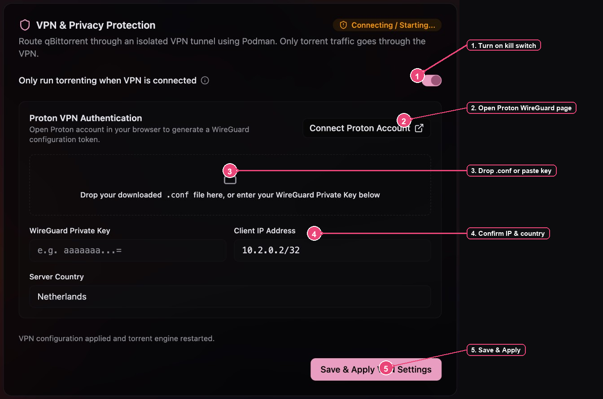
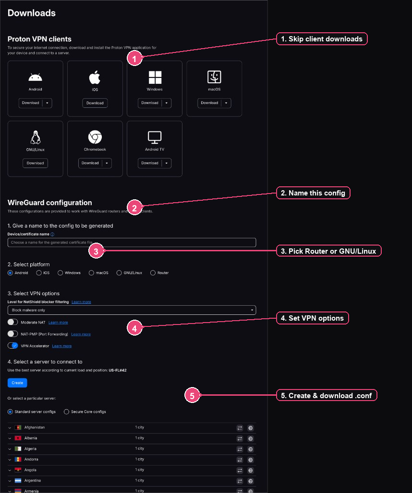
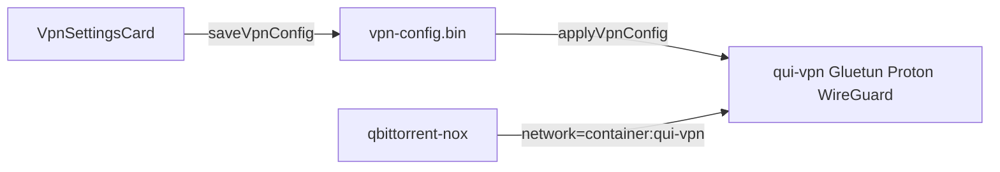

# VPN & Privacy Protection (Proton)

**Status:** shipped

Route companion qBittorrent traffic through an isolated Proton WireGuard tunnel.
Only torrent traffic uses the VPN. The Qui web UI and your browser stay on the
host network. This card appears only in **Qui Desktop** (Settings → **Instances**);
a plain browser session never shows it.

In the desktop app, the VPN card includes a **How to enable** link that opens this
page on GitHub (`docs/desktop/vpn-privacy.md` on `develop`).

## Prerequisites

- Qui Desktop with a running **Podman** machine
- A Proton VPN account that can create **WireGuard** configurations
- You do **not** need the Proton VPN desktop/mobile client for this flow

## Overview

1. In Qui, turn on the kill switch and open Proton’s WireGuard page.
2. On Proton, create and download a WireGuard `.conf` (skip the client apps).
3. Drop the `.conf` into Qui, confirm IP and country, then Save & Apply.
4. Wait until the badge reads **Protected (Kill Switch Active)**.

## Part A — Qui Desktop

Open **Settings → Instances**. The **VPN & Privacy Protection** card is at the
top of that tab.

| Step | What to do |
| ---- | ---------- |
| 1 | Turn on **Only run torrenting when VPN is connected**. While this is on, companion qBittorrent is attached to the VPN sidecar; peer and tracker traffic stop if the tunnel drops. |
| 2 | Click **Connect Proton Account**. Your system browser opens Proton’s WireGuard download page (`account.protonvpn.com/downloads#wireguard-configuration`). There is no OAuth handshake inside Qui — you generate a config on Proton’s site. |
| 3 | After you download a `.conf` (Part B), drop it on the dashed zone. Qui parses `PrivateKey` and `Address`. You can also paste the private key by hand. |
| 4 | Confirm **Client IP Address** (often `10.2.0.2/32` from Proton) and set **Server Country** to the exit country Gluetun should use (for example `Netherlands`). |
| 5 | Click **Save & Apply VPN Settings**. Qui encrypts the config, recreates the VPN sidecar and qBittorrent, and shows a short success message when apply finishes. |

## Part B — Proton WireGuard download

On the page Qui opened, scroll past **Proton VPN clients**. You only need the
**WireGuard configuration** section.

| Step | What to do |
| ---- | ---------- |
| 1 | **Skip** the OS client download cards. Qui talks to Proton via a WireGuard config file, not the Proton app. |
| 2 | Under **Give a name to the config to be generated**, enter a device/certificate name you will recognize later (for example `qui-desktop`). |
| 3 | Under **Select platform**, choose **Router** or **GNU/Linux** so Proton issues a standard `.conf`. |
| 4 | Under **Select VPN options**, set NetShield, NAT, and Accelerator to your preference. If your plan supports it, enabling **NAT-PMP (Port Forwarding)** is useful for torrenting. |
| 5 | Under **Select a server to connect to**, use Create (best server) or pick a country/city under Standard configs, then download the generated `.conf`. |

Bring that file back to Qui and drop it in the dashed zone (Part A, step 3).

## Part C — Confirm protection

After Save & Apply:

- Badge **Protected (Kill Switch Active)** means the `qui-vpn` container is running and qBittorrent is attached to its network namespace.
- Badge **Connecting / Starting...** while the toggle is on means the sidecar is still coming up (image pull or WireGuard handshake).
- Badge **Inactive** means the kill switch is off and qBittorrent runs without the VPN sidecar.

Match **Server Country** in Qui to the region you care about. Gluetun selects Proton servers from that country name (`SERVER_COUNTRIES`); regenerating a `.conf` on Proton for a different region does not replace the country field until you change it in Qui.

## Topology

Only the companion torrent engine shares the Gluetun network namespace. Qui itself
keeps serving on the host loopback.

## Spec

- `BR-desktop-50` in `docs/specs/catalog.md` — WireGuard `.conf` parse yields private key and address.
- `BR-desktop-51` in `docs/specs/catalog.md` — enabled VPN runs Gluetun as `qui-vpn` and attaches qBittorrent with `--network=container:qui-vpn`.
- `BR-desktop-52` in `docs/specs/catalog.md` — VPN settings round-trip through encrypted `VpnVault`.
- `BR-desktop-53` in `docs/specs/catalog.md` — VPN card exposes a How to enable link to this GitHub wiki page.

## Troubleshoot

| Symptom | What to check |
| ------- | ------------- |
| Stuck on **Connecting / Starting...** | Podman machine is running (`podman machine start`). First apply may pull `qmcgaw/gluetun:latest`. |
| Apply fails | Private key non-empty; country is a plain country name Gluetun accepts (`Netherlands`, `Switzerland`, `United States`, …). |
| Key/IP empty after drop | File must be a Proton WireGuard `.conf` with `[Interface]` `PrivateKey` and preferably `Address`. |
| Regenerated config on Proton | Drop the new `.conf` again and Save & Apply. Old keys stop working when Proton revokes the certificate. |
| Card missing | You are in a browser, not Qui Desktop. Open the Electron app. |
